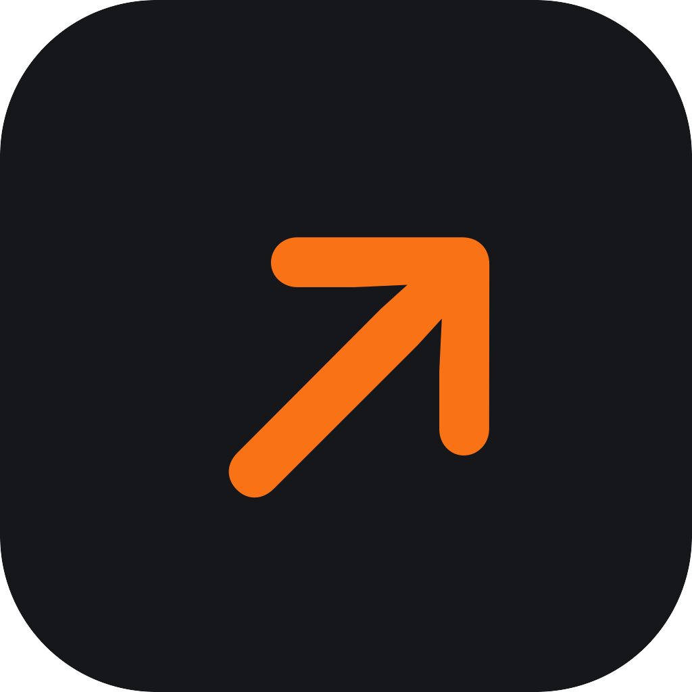

# launch-skills

Skills for AI coding agents that launch a new tool everywhere it belongs: the asset kit, cross-posts of your blog post, curated GitHub lists, app directories, community drafts and a tracker of where it is published.

They stop before every public action. Your agent fills the forms, opens the drafts and prepares the pull requests; you press publish.

Built while launching [JUMP](https://github.com/alvaldes/jump), a macOS app, on more than a dozen channels in three days. The story behind them: [I turned a product launch into Claude skills](https://www.alvaldes.dev/en/blog/launch-skills/).

## The skills

| Skill | What it does | How |
|---|---|---|
| `launch-kit` | Gathers names, taglines, descriptions and the comparison from your project, and generates every image size the channels ask for | `make-assets.sh` (ImageMagick) |
| `launch-cross-post` | Republishes your blog post on Dev.to, Hashnode and Medium as drafts, with the canonical link back to your site | `prepare-article.py` |
| `launch-lists` | Adds the tool to curated GitHub lists (awesome-mac, open-source-mac-os-apps, other awesome lists), one PR each | `insert-list-line.py`, `add-json-entry.py` |
| `launch-directories` | Fills directory and newsletter forms: AlternativeTo, MacUpdate, Indie Hackers, AppAddict, iOS Dev Weekly | Browser automation |
| `launch-community-drafts` | Drafts posts for r/macapps, Show HN, Product Hunt, LinkedIn, X and Threads, checked against each channel's rules | `check-draft.py` |
| `launch-tracker` | Keeps one table of every channel, its status and its link | Markdown |

[`references/channels.md`](references/channels.md) holds what each channel requires, from account gates (karma, cooldowns) to image sizes, as read on each site in October 2026.

## Install

### Claude Code

```text
/plugin marketplace add alvaldes/launch-skills
/plugin install launch-skills@launch-skills
```

### Other agents

Copy the folders in `skills/` to wherever your agent reads skills (for example `~/.claude/skills/`), together with `references/`, which the skills link to as `../../references/`.

## Use

Ask in plain words, from the project you are launching:

- "Prepare the launch kit for this app."
- "Cross-post my blog post about it to Dev.to and Hashnode."
- "Add it to awesome-mac and open-source-mac-os-apps."
- "Draft the Show HN and the r/macapps post."
- "What is left to publish?"

Everything for one launch lives in your project under `docs/launch/<slug>/`: `kit.md`, `assets/`, `drafts/` and `tracker.md`.

## What they will not do

- Press publish, submit, schedule or merge without your yes for that action.
- Sign in, solve CAPTCHAs or pay. Paid review queues are your call.
- Write in your voice for you. Communities like r/opensource ban AI-written posts and r/macapps removes them; drafts are a starting point you rewrite.

## Requirements

- `gh` (authenticated) for lists and repo topics.
- ImageMagick 7 (`magick`) for images.
- Python 3 for the scripts (standard library only).
- A browser automation tool for forms (for example ego-browser or Claude in Chrome). Without one, the skills give you field-by-field values.

## Development

```sh
python3 -m unittest discover -s tests
bash tests/make-assets.test.sh
claude plugin validate . --strict
claude plugin eval . --allow-tools Write Edit Bash --ablation none
```

## License

MIT. Made by [Angel L. Valdés](https://www.alvaldes.dev).
